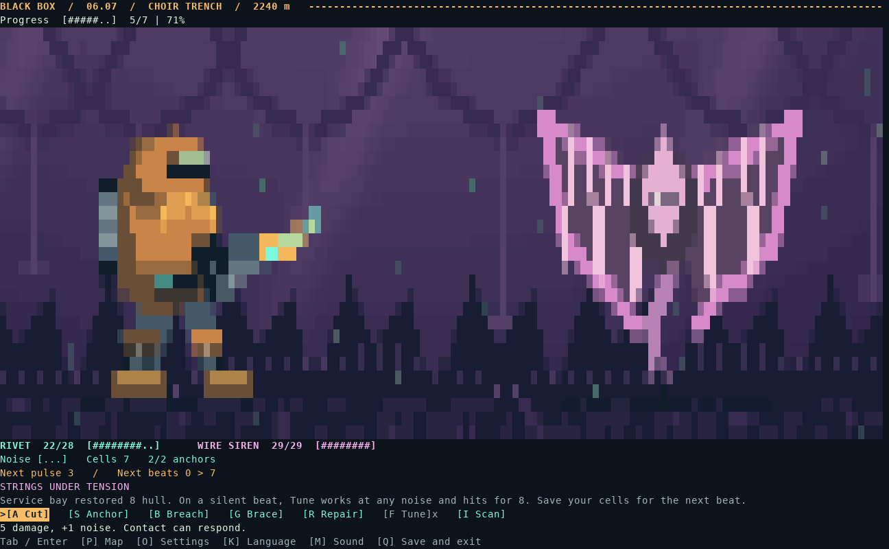

# BLACK BOX

Pelagic Station has been silent for twelve years. Six minutes ago it called you by name. Pilot a salvage rig through seven flooded sectors, fight the machines and answer the distress call at 3,100 m.



## Launch

Extract the whole archive. With Python 3.8 or newer installed, double-click **PLAY-WINDOWS.cmd**. The launcher requests a new full-screen Windows Terminal window. On a classic Windows console it requests full screen and falls back to maximizing the window. To play from a terminal in the project directory, run `python play.py`. On macOS and Linux you can use `python3 play.py`.

The first launch is in **Bulgarian**. Press **K**, then **2** for Russian or **3** for English. **1** switches back to Bulgarian. Press **1** at the main menu for Rivet or **2** for Echo. Arrows or Tab move the selection and Enter activates it. Shortcuts use Latin letters.

## First dive

Watch **Next pulse** before choosing a move. It shows the regular incoming damage for this turn. The two numbers after it show the next base beats. There is no reaction timer.

1. Start as **Rivet**. At the flood lock, press **A** twice. The lantern drone has 1 hull left and the hydrophone lights up.
2. Press **F**, then **1**, **3**, **2**. The notes are printed as well as played. Matching them finishes the drone. A third **A** also finishes it before it can return fire.
3. At the service bay, choose **2** to repair your rig, or **1** for a spare cell. At the pump cathedral, try **B** to break the crab's closed shell.

| Key | In combat |
| --- | --- |
| A | Cut for 5 before armor, gaining one noise mark. A third consecutive noise mark grants a surviving enemy +3 on that hit. |
| S | Rivet absorbs the pulse with one of two anchors per sector. Echo spends one cell to reflect the announced damage. Both clear noise. |
| B | Breach for 7 and disable armor for the rest of the sector. One use per sector. |
| G | Brace to clear noise and absorb up to 4 damage. |
| R | Spend a cell to restore up to 12 hull. A surviving contact can respond. |
| F | At two noise marks, answer the contact's three-note signature. A match deals 4 and cancels its reply. The Siren has a special opening. |
| I | Inspect the pulse cycle, signature and sector tactic. |
| P | Open the map. Browse with arrows, Tab or 1–7. Read recovered recordings by selecting a cleared sector. |
| O / K / M | Open settings, choose a language, or toggle music and effects. |
| Q | Save the dive and exit. Choose **C** on the next launch to continue. |

In the hydrophone, **L** replays the call, **Backspace** edits the answer and **X** returns to combat. An incorrect phrase costs nothing. On the map, **[x]** means cleared, **[>]** current and **[.]** locked.

## The descent

| Depth | Sector | Contact | Read the fight |
| ---: | --- | --- | --- |
| 180 m | Flood lock | Lantern drone | The alternating short and long pulses introduce noise and tuning. |
| 460 m | Pump cathedral | Piston crab | Its shell closes on pulse 5. Breach removes the armor. |
| 790 m | Tape archive | Spindle eel | It adds 2 damage at two noise marks. |
| 1,200 m | Recorder vault | The Listener | Its shield activates at half hull. |
| 1,680 m | Glass reef | Kiln Nautilus | On pulse 1 the shell opens to vent. The cutter hits for 8. |
| 2,240 m | Choir trench | Wire Siren | A silent beat opens the hydrophone at any noise level. Answer for 8 before the strings tighten. |
| 3,100 m | Tidal well | The Tide Crown | At half hull the beat changes to 8 / 0 / 7. Brace on either heavy beat to send 4 damage back. |

Both rigs start with 28 hull and two cells. Every cleared non-final sector grants one cell and a service choice. Your hull and cells carry forward. Anchors and Breach reload at each new sector.

## Progress and display

The game automatically saves each resolved turn and service choice. Continue restores hull on both sides, the enemy's exact beat, noise, inventory and ability charges. You can also leave an unclaimed service reward for the next session. Defeat lets you retry the same sector from its entrance. The surface map remembers the deepest clearance, including all recovered tapes after victory. Starting a new dive over an active one asks for confirmation.

**O** opens settings on the surface, in combat, in the service bay and at the hydrophone. Sound, animation, language, rendering and the regular or bold instrument type change immediately. Window mode applies on the next Windows launch. Health and noise always use plain keyboard characters, such as `[######....]`.

| Drawing mode | Appearance |
| --- | --- |
| Color cells | The default. Colored backgrounds paint each cell using ordinary spaces. |
| Fine pixels | A half-block glyph fits two vertical pixels into each cell. |
| ASCII shading | Brightness is drawn with a ramp of ordinary characters. Also available with `NO_COLOR=1`. |

Classic Windows Console Host offers **Consolas**, **Lucida Console** or the original host font in the game's settings. Windows Terminal uses the font configured in its profile. The game restores the classic console font when it exits normally.

Settings and the campaign are stored separately in `settings.json` and `campaign.json`. The Windows folder is `%LOCALAPPDATA%\BlackBoxAbyss`. macOS uses `~/Library/Application Support/BlackBoxAbyss`. Linux uses `$XDG_DATA_HOME/black-box-abyss`, or `~/.local/share/black-box-abyss`. Set `BLACKBOX_DATA_DIR` to use another directory. These command-line options apply to a single launch.

```sh
python play.py --lang ru
python play.py --mute
python play.py --still
python play.py --plain
```

## Sound and code

Seven original scores share a 100 BPM clock. The mixer crossfades at sector boundaries and adds a heartbeat when the receiver opens or the rig reaches low hull. Effects follow the visual impact frame. The hydrophone displays every note for silent play. Windows WaveOut, macOS AudioQueue and available Linux audio backends play the bundled PCM samples. To regenerate them from the synthesizer, run `python tools/compose.py`.

Python's standard library runs the game and its tests. `Dive` resolves turns, `Hero` delegates its special move to `Rivet` or `Echo`, and each rig owns an `Inventory` of cells. Run the full suite from the game directory.

```sh
python -m unittest -v
```
